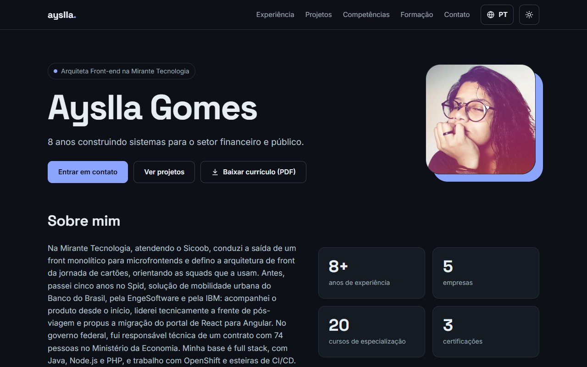

# Currículo online — Ayslla Gomes

Currículo e portfólio em página única, em **português, inglês, espanhol e italiano**, com versão em **PDF** gerada a partir do próprio site.

🌐 **https://aysllagomes.dev** · [PT](https://aysllagomes.dev/pt/) · [EN](https://aysllagomes.dev/en/) · [ES](https://aysllagomes.dev/es/) · [IT](https://aysllagomes.dev/it/)



## Destaques técnicos

- **Angular 22** com componentes standalone, change detection **OnPush** e **sem zone.js**; TypeScript `strict`.
- **Páginas geradas no build** (`@angular/ssr`, saída estática): cada idioma chega pronto no HTML e o Angular reaproveita esse HTML no navegador (hidratação). Sem servidor.
- **4 idiomas sem biblioteca de tradução:** uma rota por idioma; os testes garantem que nenhuma tradução fique faltando.
- **PDF de 2 páginas A4 por idioma**, gerado no build a partir do CSS de impressão do site: nunca fica diferente da página e é legível por sistemas de triagem (ATS).
- **Busca e prévia de links:** `canonical`, `hreflang`, Open Graph com imagem por idioma, dados estruturados (JSON-LD) e sitemap.
- **Projetos vindos do GitHub:** entram os repositórios com o tópico `portfolio`.
- **Qualidade no deploy:** 126 testes de unidade (Vitest) e 54 de ponta a ponta (Playwright, no computador e no celular) rodam antes de cada publicação.
- **Sem cookies:** estatísticas com GoatCounter; nenhum banner de consentimento.
- Layout próprio com flex/grid, sem framework de CSS; tema claro e escuro; fontes servidas pelo próprio site.

## Rodando localmente

Requisito: **Node 26** (ou 24.15+ / 22.22.3+). Veja `.nvmrc`; com nvm: `nvm use`. Os comandos de PDF, imagens de prévia e testes de ponta a ponta usam o **Chrome** (ou o Edge) instalado no computador.

```bash
npm install
npm start               # http://localhost:4200
npm test                # testes de unidade (Vitest)
npm run lint            # ESLint (angular-eslint)
npm run build:pages     # o mesmo build que vai para o ar (dist/curriculum/browser), com os PDFs
npm run e2e             # testes de ponta a ponta no site gerado pelo build:pages
node scripts/serve.mjs  # o site gerado pelo build:pages em http://127.0.0.1:4300/, como no GitHub Pages
npm run pdf             # só os PDFs (dist/curriculum/browser/cv), para conferir o layout de impressão
npm run og              # gera de novo as imagens de prévia de links (src/assets/og/)
npm run projects        # atualiza a lista de projetos a partir do GitHub
```

## Atualizando o conteúdo

| O que mudar | Onde |
| --- | --- |
| Perfil, experiências, formação, cursos, certificações, competências, idiomas | `src/app/data/pt-BR.ts` (a fonte de tudo) |
| Os mesmos textos em inglês, espanhol e italiano | `src/app/data/en.ts`, `es.ts`, `it.ts` |
| Menus, botões e títulos das seções | `src/app/data/labels.ts` |
| Projetos: quais entram | tópico `portfolio` no repositório do GitHub |
| Projetos: ordem e descrição em cada idioma | `src/app/data/projects.ts` |
| Foto no PDF por idioma | `printPhoto` em `src/app/data/locales.ts` |
| Quantos projetos entram no PDF | `printLimit` em `personal-projects.component.ts` |

**Regras que os testes conferem** (rode `npm test` antes de publicar):

- Datas no formato `AAAA-MM`; experiência sem `end` é o emprego atual. As durações ("3 anos e 7 meses") e os números da abertura são calculados.
- Na frase de abertura (`headline`), `{anos}` vira os anos de experiência; o texto nunca fica desatualizado.
- Datas, links, empresas e nomes de cursos entram só no `pt-BR.ts`. Todo texto novo (resumo, destaques de experiência, descrição de projeto) precisa da tradução nos outros 3 idiomas: experiência sem tradução quebra o build.
- Experiências podem ter `summary` (uma frase de contexto), `highlights` (um item por linha) e `stack`. Quando o mesmo trabalho passou por mais de uma empresa (o Spid, pela EngeSoftware e depois pela IBM), a anterior entra em `earlier` e aparece no mesmo cartão, com as próprias datas.

**Projetos:** marque o repositório com o tópico `portfolio` (engrenagem ao lado de *About* → *Topics*). A cada build, `scripts/fetch-projects.mjs` grava a lista em `src/app/data/github-projects.json`; se o GitHub não responder, vale a última lista salva. Linguagem, tópicos e "Ver demo" (campo *Website*) vêm do próprio repositório.

**Mudou o cargo ou a frase de abertura?** Rode `npm run og` e faça commit das imagens: elas trazem esses textos. O PDF se atualiza sozinho no deploy.

## Como funciona

- **Idiomas e rotas:** uma rota por idioma (`/pt`, `/en`, `/es`, `/it`), todas com o `CurriculumComponent`; cada rota fornece o idioma, o conteúdo e os textos da interface (`locales.ts`). A raiz `/` leva ao idioma escolhido antes no seletor ou ao do navegador.
- **Páginas no build:** `pt/index.html`, `en/index.html`… saem prontas, com título, descrição, Open Graph, `canonical`, `hreflang` e JSON-LD (`head.ts`, `structured-data.ts`). A raiz e o `404.html` são a versão que roda só no navegador (`scripts/pages-fallback.mjs`).
- **PDF:** `scripts/pdf.mjs` abre as páginas do build num Chrome sem janela e salva `cv/ayslla-gomes-<idioma>.pdf`, usando o CSS de impressão (`@media print` em `src/styles.scss` e nos componentes). O mesmo layout vale para quem imprime o site pelo navegador.
- **Imagens de prévia:** `scripts/og-images.mjs` monta uma arte 1200×630 por idioma com os textos das páginas geradas.
- **Tema:** segue o sistema, com botão no cabeçalho. As cores ficam no início de `src/styles.scss`; a escolha é lembrada no navegador e aplicada por um script curto no `index.html` antes da página aparecer.
- **Estatísticas:** o contador do GoatCounter é carregado só no navegador e conta as visitas e os downloads do PDF (eventos `pdf-pt`, `pdf-en`…). A conta fica em `GOATCOUNTER_CODE` (`analytics.ts`); vazio desliga.

```
├── .github/
│   ├── workflows/deploy.yml   # lint, testes, build, testes de ponta a ponta e deploy
│   └── dependabot.yml         # PRs semanais com versões novas das dependências
├── e2e/                       # testes de ponta a ponta (Playwright)
├── scripts/
│   ├── fetch-projects.mjs     # projetos do GitHub (tópico "portfolio")
│   ├── pages-fallback.mjs     # index.html da raiz e 404.html
│   ├── pdf.mjs                # currículo em PDF de cada idioma
│   ├── og-images.mjs          # imagens de prévia de links
│   ├── serve.mjs              # o build servido como no GitHub Pages
│   └── lib/browser.mjs        # Chrome sem janela e servidor local, usados pelos scripts acima
└── src/
    ├── app/
    │   ├── data/              # conteúdo por idioma, textos da interface, idiomas e rotas, <head>, JSON-LD, projetos
    │   ├── pages/             # seções da página (hero, about, experience, personal-projects…)
    │   ├── shared/
    │   │   ├── components/    # rodapé
    │   │   ├── models/        # tipos dos dados
    │   │   └── utils/         # datas e durações, tema, estatísticas, endereços, armazenamento do navegador
    │   ├── app.config.ts      # providers do navegador (rotas, sem zone.js, hidratação, estatísticas)
    │   └── app.config.server.ts / app.routes.server.ts   # páginas geradas no build
    ├── assets/og/             # imagens de prévia (1200×630) de cada idioma
    ├── index.html             # <head> comum (verificação do Google, tema, preconnect das imagens)
    └── sitemap.xml
```

## Qualidade

| Verificação | Como |
| --- | --- |
| Testes de unidade | 126 testes (Vitest): dados e traduções, datas, componentes, dados estruturados, estatísticas |
| Testes de ponta a ponta | 27 cenários no computador e no celular (54 no total, Playwright) no site gerado pelo build: idiomas e redirecionamentos, tema, menu, PDF, impressão, 404, dados para o Google |
| Lint | ESLint com angular-eslint |
| Lighthouse | Desempenho 95–97 no celular e 100 no computador; acessibilidade, boas práticas e SEO 100 (medição de 07/11/2026) |
| Dependências | Dependabot abre PRs toda segunda; o workflow valida cada um |

## Publicação e infraestrutura

A publicação é automática pelo **GitHub Actions** (`.github/workflows/deploy.yml`):

- **Pull request para a `main`:** lint, testes, build e testes de ponta a ponta (não publica).
- **Push na `main`:** o mesmo e, se tudo passar, deploy no GitHub Pages. Se algum teste falhar, nada é publicado e o relatório fica salvo no workflow.
- **Toda segunda-feira, 6h (Brasília):** build e deploy automáticos, para as durações calculadas não ficarem desatualizadas.
- **Manual:** aba *Actions* → *Build e deploy no GitHub Pages* → *Run workflow*.

**O que fica onde:**

| Serviço | Onde | Configuração |
| --- | --- | --- |
| Hospedagem | GitHub Pages | Repositório → *Settings → Pages*: origem **GitHub Actions**, domínio `aysllagomes.dev`, *Enforce HTTPS* |
| Domínio | Cloudflare Registrar | `aysllagomes.dev`, renovação automática todo 18 de novembro |
| DNS | Cloudflare | 4 registros `A` para o GitHub Pages e `www` → `aysllagomes.github.io` (sem proxy); TXT de verificação do GitHub e do Google; MX, SPF e DKIM do e-mail |
| Imagens (foto e logos) | Cloudflare R2 | Bucket `images-curriculum`, servido em `img.aysllagomes.dev` (TLS mínimo 1.2; acesso `r2.dev` desligado) |
| E-mail | Cloudflare Email Routing | `ayslla@aysllagomes.dev` encaminhado para a caixa pessoal (só recebe) |
| Busca | Google Search Console | Propriedade de domínio `aysllagomes.dev`, com o sitemap; a tag de verificação fica no `src/index.html` (não apague) |
| Estatísticas | GoatCounter | Painel em https://ayslla-gomes.goatcounter.com |
| Dependências | Dependabot | `.github/dependabot.yml` |

O endereço antigo `aysllagomes.github.io/curriculum/` redireciona para o domínio.

## Manutenção periódica

| Quando | O quê |
| --- | --- |
| Toda segunda | Revisar os PRs do Dependabot: verde pode entrar; vermelho precisa de ajuste |
| Ao mudar cargo ou frase de abertura | `npm run og` e commit das imagens de prévia; atualizar o título no LinkedIn |
| Setembro (aniversário de carreira) | `npm run og`, para a prévia mostrar o novo número de anos; trocar o número no título do LinkedIn |
| Novembro | Renovação do domínio (automática): conferir se o cartão da Cloudflare está válido |
| Projeto novo no GitHub | Tópico `portfolio` no repositório e descrição nos 4 idiomas em `projects.ts` |

O histórico de decisões e entregas está no [PLANO.md](PLANO.md).
